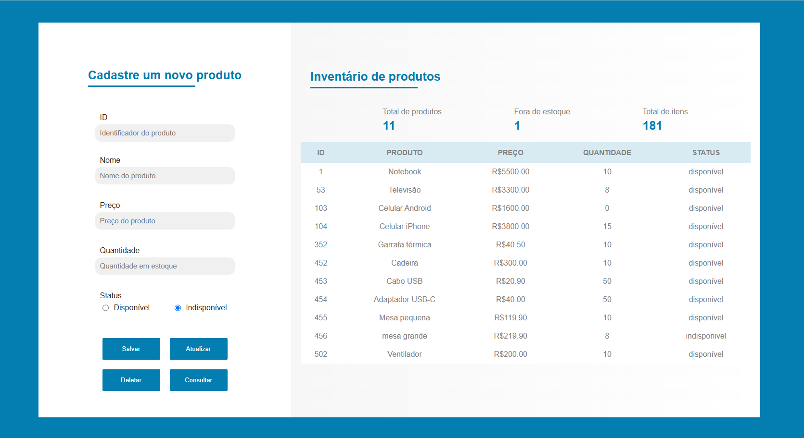

# Gerenciador de Produtos

## Descrição
Aplicação full stack desenvolvida com Java e Spring Boot para gerenciamento de produtos, utilizando PostgreSQL para persistência de dados e publicada na plataforma Render com Docker.  
Você pode visualizar o projeto <a href="https://projeto-produtos-com-springboot-3.onrender.com/">aqui</a>.

## Funcionalidades
- Cadastrar novos produtos
- Atualizar informações de produtos
- Deletar produtos
- Listar todos os produtos
- Buscar produtos por nome (contendo, iniciando ou terminando com uma string informada)
- Buscar produtos por preço (exato, maior ou menor que o informado)
- Validação de dados

## Tecnologias utilizadas
1. Java
2. Spring Boot
3. PostgreSQL
4. Spring Data JPA + Hibernate + JPQL
5. JavaScript
6. HTML 
7. CSS
8. Maven
9. Docker

## Interface

    

## Endpoints da API
### Endpoints CRUD

| Método | Endpoint | Descrição 
|--------|----------|-----------
|GET | `/produtos`| lista todos os produtos
|GET | `/produtos/{id}` | procura produto por ID
|POST | `/produtos`| adiciona um produto
|PUT | `/produtos/{id}` | altera informações de um produto
| DELETE | `/produtos/{id}` | remove um produto

### Endpoints para buscas detalhadas
| Método | Endpoint | Descrição 
|--------|----------|-----------
|GET | `/buscarPorNome` | busca um produto pelo seu nome exato
|GET | `/buscarPorNomeContendo` | busca um produto que contém uma string
|GET | `/buscarPorNomeComecandoCom` | busca um produto que comece com uma string fornecida
|GET | `/buscarPorNomeTerminandoCom` | busca um produto que termine com uma string fornecida
|GET | `/buscarPorNomeEStatus` | busca um produto e um status (disponível/indisponível)
|GET | `/buscarPorPreco` | busca um produto de preço extato
|GET | `/buscarPorPrecoMenorQue` | busca produtos com preço menor que o informado
|GET | `/buscarPorPrecoMaiorQue` | busca produtos com preço maior que o informado
* Ainda não foram implementadas no Front-end

## Como executar o projeto
1. Clone o repositório: `git clone https://github.com/sapicenn/projeto-produtos-com-springboot`
2. Abra na sua IDE preferida
3. Execute a classe `MeuProjetoSpringBootApplication.java`
4. Acesse `http://localhost:8080` no seu navegador

## Autor
Desenvolvido por Sarah Picenni de Oliveira
